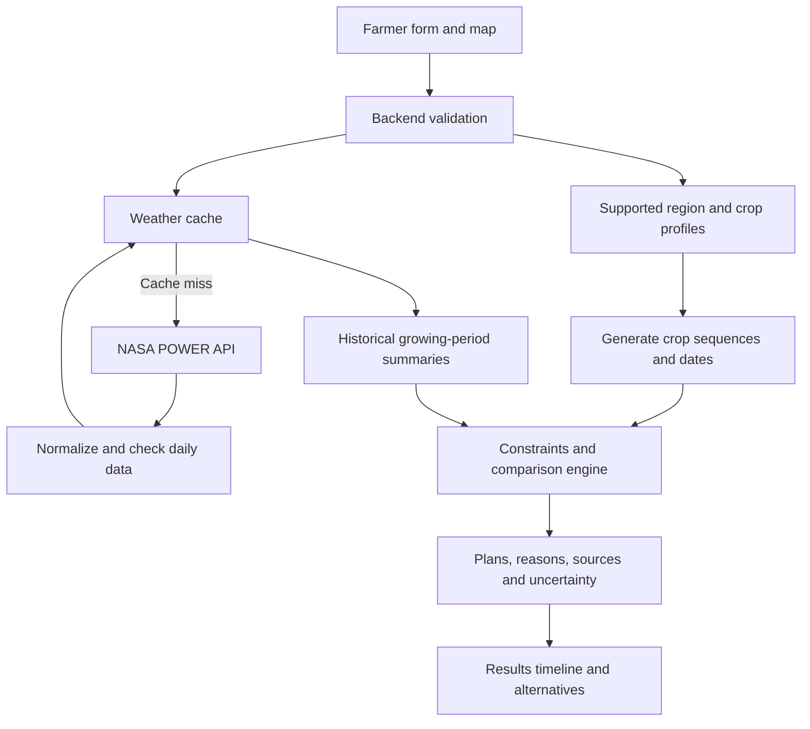

# Rotavise — complete project blueprint

**Tagline:** Grow with a plan.  
**Challenge:** Field Shift: Adapting Farms with NASA Data  
**Team lead:** Houdaifa Drahm — backend and DevOps  
**Local event:** Beni Mellal, Morocco  
**Document date:** September 26, 2026  
**Status:** Proposed product and engineering plan. The application has not been built or validated by this document.

## Read this first

Rotavise will be a website that works on phones and laptops. A farmer tells us about a field, what was planted before, available water, and when they want to plant. Our backend compares possible crop plans for the next two growing seasons and returns a recommended plan, alternatives, and reasons.

The farmer does **not** have to choose the crops to compare. Rotavise generates the options from its supported crop catalog. The farmer can optionally exclude crops they cannot grow or sell.

The essential flow is:

**Farmer’s answers → NASA weather history + sourced crop requirements → generate crop sequences → check constraints → compare suitable plans → explain the results.**

The ambition is a product that can eventually serve different countries. The hackathon prototype should cover one researched region and a small crop catalog. An app that accepts coordinates worldwide is not automatically able to give reliable worldwide farming advice.

### Decisions in this blueprint

| Item | Decision |
| --- | --- |
| Team and product name | Rotavise |
| Product format | Responsive web app; no native mobile app required |
| First supported region | A documented area around Beni Mellal |
| Planning horizon | Two successive growing seasons on the same field |
| Candidate crops | Research onions, broad beans, and carrots first; activate only profiles with enough reviewed information |
| Main NASA integration | NASA POWER Daily Point API |
| Initial weather variables | Daily minimum temperature, maximum temperature, corrected precipitation |
| Crop knowledge | A small sourced database maintained by the team |
| Recommendation method | Transparent constraints and comparison rules |
| AI in the first version | Not required; no AI model in the core ranking |
| Soil moisture or vegetation API | Optional later addition after product and layer verification |
| Main output | A crop sequence, alternatives, reasons, sources, and missing information |

These are our implementation choices. They are not all NASA requirements.

## Reading guide

1. Challenge fit and confirmed requirements
2. Farmer story and product scope
3. User inputs and frontend workflow
4. Architecture and technology choices
5. NASA POWER integration and a real response
6. Crop knowledge and database design
7. Complete recommendation algorithm
8. API contracts and result presentation
9. Uncertainty, failure handling, and validation
10. Team roles, hackathon plan, demo, and future product

For a quick first read, start with Sections 1–5 and 11. For implementation, use Sections 7–17. For the team and event plan, use Sections 21–28. The numbered sections below provide the full detail.

---

## 1. What the challenge asks us to solve

The published summary describes a decision support tool for exploring crop rotations under changing weather, water pressure, and soil conditions. It calls for NASA Earth observations, local soil information, crop characteristics, and farmer priorities. Our interpretation is to compare sequences of crops across successive seasons and explain how each sequence fits those inputs. [Official Field Shift summary](https://www.spaceappschallenge.org/2026/challenges/field-shift-adapting-farms-with-nasa-data/).

The important unit is a **plan across seasons**:

```text
Previous crop → Next growing season → Following growing season
```

For example:

```text
Previously: onions
Candidate A: broad beans → onions
Candidate B: carrots → broad beans
Candidate C: onions → onions
```

These are candidate sequences for explaining the software. They are **not approved recommendations or confirmed Beni Mellal planting calendars**. The engine must check varieties, dates, water, soil, and rotation rules before it can recommend any sequence.

### How the app matches the summary

| Challenge element | Rotavise feature |
| --- | --- |
| NASA data | Historical weather from POWER, with provenance |
| Local soil information | Farmer or laboratory inputs with units and an “unknown” option |
| Crop characteristics | Sourced profiles for supported crops and varieties |
| Farmer priorities | Water conservation, rotation diversity, and other supported goals |
| Rotation strategies | Compare sequences, including the previous crop where known |
| Adaptation to conditions | Show historical heat, cold, rainfall, and dry-period exposure |
| Exploration | Alternatives and a “change inputs and compare again” workflow |

Only the summary was visible on the challenge page when this document was prepared. Recheck the complete challenge statement, resource list, and judging instructions when available. POWER is a proposed integration, not a confirmed mandatory dataset. Its meteorological data is reanalysis, so inspect the final challenge resources to determine whether a specific direct satellite observation product is also expected.

## 2. A concrete farmer story

Imagine a farmer with a field near Beni Mellal. They planted onions last season. They have limited irrigation and want help planning the next two growing seasons.

They open Rotavise on their phone:

1. Tap the field’s location on a map.
2. Select **Onions** as the previous crop.
3. Describe the soil, or select **I don’t know**.
4. Select **Limited irrigation**.
5. Choose when the field will be available and how flexible planting dates are.
6. Choose **Use less water** as the main priority.
7. Tap **Find a planting plan**.

The backend checks the supported crop profiles and possible sequences. It uses historical weather for the same growing periods, checks timing and rotation rules, and compares the remaining plans.

The result might take this form:

> **A plan to explore:** broad beans, followed by onions.  
> This changes the crop family after your previous onions. Here is how its historical weather exposure compares with the alternatives. Your soil information is incomplete, and irrigation adequacy still needs checking.

That wording illustrates the interface. It does not establish that this sequence wins in a real field. The actual result must come from the calculation.

The farmer can then change the water input or planting dates and run the comparison again.

## 3. Exactly what we should build for the hackathon

### Essential features

- [ ] A landing page explaining the product in one paragraph.
- [ ] A field-location selector with manual coordinate entry as a fallback.
- [ ] A short farmer form with explicit units and unknown options.
- [ ] A reviewed catalog of a few crops for the supported region.
- [ ] A backend connection to NASA POWER.
- [ ] Weather normalization, missing-value checks, and caching.
- [ ] Generation of two-season crop sequences.
- [ ] Calendar, crop-history, soil, and water checks.
- [ ] A transparent comparison and ranking method.
- [ ] A results page with a timeline and up to two alternatives.
- [ ] Reasons and source references for each result.
- [ ] A conditional-result state when important information is missing.
- [ ] A “no supported plan” state when nothing passes the checks.
- [ ] A reproducible demo and deployment.

### Leave for later

Native Android/iOS apps, automatic disease diagnosis, market-price predictions, exact yield forecasts, fertilizer prescriptions, a global crop catalog, satellite imagery processing, and an AI chatbot can wait until the basic planner works.

The first prototype should do one useful task well: **compare a small set of credible crop sequences for one field and explain the differences**.

## 4. Farmer inputs: fields, examples, and validation

### 4.1 Required inputs

| Field | What the farmer enters | Example | Backend rule |
| --- | --- | --- | --- |
| Location | A map pin or coordinates | Latitude `32.34`, longitude `-6.36` | Latitude −90 to 90; longitude −180 to 180; then check supported region |
| Previous crop | Catalog choice, other, unknown, or nothing planted | `onion` | Do not interpret unknown as no crop |
| Field available from | Earliest possible next planting date | `2026-11-20` | Valid date; planning example, not an endorsed planting date |
| Planting flexibility | Fixed date or an allowed date range | Up to 30 days later | Limit the search to the supplied range |
| Water availability | Rain only, limited irrigation, reliable irrigation, or unknown | Limited irrigation | Qualitative input; not a measured seasonal water budget |
| Priority | Supported goal | Use less water | Map to a documented comparison preset |

The exact example coordinate is a public demonstration point near Beni Mellal, not a surveyed farmer’s property.

### 4.2 Optional inputs with an explicit unknown state

| Field | Example | Why it matters |
| --- | --- | --- |
| Field area | `1.5 ha` | Necessary for volume-to-depth conversion if a later water model uses it |
| Earlier crop history | Crop and dates for prior seasons | A previous crop alone cannot establish a multi-year rotation break |
| Soil texture | Sandy, loamy, clayey, or laboratory proportions | Helps compare supported soil preferences |
| Drainage | Good, poor, or unknown | Needed for crops with sourced drainage constraints |
| Soil pH | `7.2`, with sample date | Compare only with requirements using the same interpretation |
| Soil salinity | Value plus method and units, if known | Do not compare different salinity measures as if identical |
| Irrigation budget | Volume or depth over a named period | Optional advanced input; units and timeframe are essential |
| Irrigation method | Drip, sprinkler, surface, unknown | Relevant to an eventual water model |
| Unwanted crops | A list | Avoid recommending crops the farmer cannot use |
| Residue handling | Removed, retained, unknown | Relevant if a sourced rotation rule depends on residues |
| Planting method and variety | Direct sowing, transplanting, cultivar | Crop duration and temperature response can change |

Ask for information the engine actually uses. Do not collect complicated soil measurements just to make the form look scientific.

### 4.3 Handling crop history correctly

- **Nothing planted during a known period:** the field was empty during that period.
- **Unknown history:** we cannot check the earlier crops.
- **Other crop:** record its name; resolve its family or show that the rotation check is incomplete.
- **Known previous crop:** check the transition from that crop into the first proposed crop.

An empty field does not imply healthy soil, no pathogens, or an unlimited water supply.

## 5. Frontend pages and user experience

### Page A — Home

Suggested text:

> **Rotavise. Grow with a plan.**  
> Explore what to plant over the next growing seasons using NASA weather history and farming knowledge.

Primary button: **Plan my field**.

Show the supported region and that this is a prototype. Avoid “perfect crop,” “guaranteed profit,” or “NASA-approved recommendations.”

### Page B — Field and farmer form

Use three short steps:

1. **Your field:** map location, previous crop, known soil information.
2. **Your resources:** water availability, optional area and budget.
3. **Your plan:** earliest planting date, flexibility, priority, crop exclusions.

Show an input summary before calculation. All form labels should make units clear. Coordinates can be generated from a map pin; the farmer does not have to understand latitude and longitude.

### Page C — Processing

Use factual progress messages:

- Getting historical weather.
- Checking the available crop profiles.
- Comparing planting plans.

Avoid presenting the algorithm as an AI expert when no AI model is involved.

### Page D — Results

Show these in order:

1. Recommended or provisional plan.
2. Crop timeline for the two seasons.
3. Three short reasons tied to the actual calculation.
4. Water-demand comparison and historical weather exposure.
5. Up to two alternative plans.
6. Missing information, assumptions, and sources.
7. **Change my inputs** button.

Include a compact **How was this calculated?** section. Keep developer details out of the main farmer flow.

English is enough for the first working build. Add French or Arabic only if someone can review the content and interface; Arabic needs right-to-left layout support.

## 6. Architecture



### Recommended stack

| Part | Proposal | Responsibility |
| --- | --- | --- |
| Frontend | React + TypeScript | Form, map, timeline, comparisons |
| Map | Leaflet with a suitable tile provider | Field pin and coordinate capture |
| Backend | Python + FastAPI | NASA integration, rules, calculations, API |
| Data analysis | Python date/numeric utilities | Growing-period summaries and checks |
| Database | PostgreSQL; JSON catalog files are enough for an initial small prototype | Crop profiles, rule versions, cache metadata |
| Deployment | Docker on infrastructure Houdaifa knows | Repeatable backend deployment |
| Source control | A shared Git repository | Ownership, changes, reproducibility |

This is a proposed stack, not a requirement. Use the team’s existing strengths. A separate queue, Kubernetes cluster, or microservice architecture is unnecessary for a few crops and one NASA integration. [React documentation](https://react.dev/), [FastAPI documentation](https://fastapi.tiangolo.com/), [Leaflet documentation](https://leafletjs.com/).

### Backend modules

```text
backend/
  api/               request validation and endpoints
  weather/           NASA client, normalization, cache
  crops/             profiles, sources, regional support
  calendars/         planting windows and crop durations
  planning/          sequence generation
  rules/             constraints and transition checks
  scoring/           comparison, sensitivity, explanations
  storage/           persistence and cache repositories
  tests/             meaningful fixtures and invariants

frontend/
  field-form/
  map/
  results/
  sources/

data/
  crops/
  regional-calendars/
  rotation-rules/
  sources/
```

Use this as a proposed organization during the build. No project code is generated by this document.

## 7. NASA POWER: exactly what it does

POWER provides daily historical solar and meteorological data. Our selected endpoint returns a point time series using coordinates, dates, and requested variables. JSON is supported; daily data defaults to Local Solar Time. The documented single-point limit is 20 parameters per request. [Daily API documentation](https://power.larc.nasa.gov/docs/services/api/temporal/daily/).

We initially request:

| Parameter | Meaning in the response | Unit |
| --- | --- | --- |
| `T2M_MIN` | Daily minimum air temperature at 2 metres | Celsius, response unit `C` |
| `T2M_MAX` | Daily maximum air temperature at 2 metres | Celsius, response unit `C` |
| `PRECTOTCORR` | Corrected daily precipitation | `mm/day` |

Read the response metadata rather than assuming units for every future variable. The official [Parameter Dictionary guide](https://power.larc.nasa.gov/docs/tutorials/parameters/) explains how to inspect parameter definitions, units, and availability.

### 7.1 Endpoint and exact test request

```text
GET https://power.larc.nasa.gov/api/temporal/daily/point
```

Query parameters:

```text
parameters=T2M_MIN,T2M_MAX,PRECTOTCORR
community=AG
latitude=32.34
longitude=-6.36
start=20250101
end=20250103
format=JSON
time-standard=LST
```

`AG` selects the agroclimatology community. It is not a crop ID. Dates use `YYYYMMDD`. The location is coordinates, not a city name or street address. This request needs no request body or API key; the public request was tested successfully on September 26, 2026.

Copyable command:

```bash
curl --get 'https://power.larc.nasa.gov/api/temporal/daily/point' \
  --data-urlencode 'parameters=T2M_MIN,T2M_MAX,PRECTOTCORR' \
  --data-urlencode 'community=AG' \
  --data-urlencode 'latitude=32.34' \
  --data-urlencode 'longitude=-6.36' \
  --data-urlencode 'start=20250101' \
  --data-urlencode 'end=20250103' \
  --data-urlencode 'format=JSON' \
  --data-urlencode 'time-standard=LST'
```

### 7.2 Real response from that request

The following is a shortened response containing real returned values. Processing-time fields and the geometry are omitted.

```json
{
  "type": "Feature",
  "properties": {
    "parameter": {
      "T2M_MIN": {
        "20250101": 2.79,
        "20250102": 2.37,
        "20250103": 3.98
      },
      "T2M_MAX": {
        "20250101": 13.75,
        "20250102": 17.18,
        "20250103": 16.59
      },
      "PRECTOTCORR": {
        "20250101": 0.4,
        "20250102": 0.0,
        "20250103": 0.0
      }
    }
  },
  "header": {
    "title": "NASA/POWER Source Native Resolution Daily Data",
    "api": {
      "version": "v2.10.0",
      "name": "POWER Daily API"
    },
    "sources": ["MERRA2", "POWER"],
    "fill_value": -999.0,
    "time_standard": "LST",
    "start": "20250101",
    "end": "20250103"
  },
  "parameters": {
    "T2M_MIN": {
      "units": "C",
      "longname": "Temperature at 2 Meters Minimum"
    },
    "T2M_MAX": {
      "units": "C",
      "longname": "Temperature at 2 Meters Maximum"
    },
    "PRECTOTCORR": {
      "units": "mm/day",
      "longname": "Precipitation Corrected"
    }
  },
  "messages": []
}
```

For January 1, 2025, this returned a minimum of **2.79°C**, maximum of **13.75°C**, and precipitation of **0.4 mm/day**.

These three days only demonstrate the API. They are not enough for the planning engine.

### 7.3 Requesting years of history

For a five-complete-year baseline when planning in 2026:

```text
start=20210101
end=20251231
```

Use the last complete years rather than treating a partial current year as complete. The exact five-year request above is the proposed baseline; this document’s new live test used the three-day request.

If a crop or two-season plan crosses New Year, match **complete historical windows**. Five calendar years do not always contain five complete cross-year examples. Either report the actual smaller number, or request an additional buffer year. Never silently truncate a growing period to fit the downloaded data.

Example: five historical analogs of a two-calendar-year plan could start in 2020–2024 and finish in 2021–2025. That requires weather covering 2020–2025. It is five analog plans using six calendar years of records.

The baseline length is a product choice. Five years is a small sample for long-term climate claims; present historical conditions and variation, not a future climate forecast.

### 7.4 Data accuracy and spatial meaning

POWER’s meteorological variables are based on MERRA-2 reanalysis, combining observations and modeling. NASA describes its source meteorological grid as approximately **0.5° latitude × 0.625° longitude**. Values represent grid areas, not a sensor in a specific farm. [Meteorological methodology](https://power.larc.nasa.gov/docs/methodology/meteorology/).

Therefore:

- Neighbouring fields may receive the same weather values.
- Coordinates with many decimal places do not make the source data field-scale.
- Mountains, local rain, irrigation, and soil conditions may differ within a grid area.
- Historical temperature and rainfall do not establish soil fertility, crop yield, or future weather.
- Keep Local Solar Time separate from the Morocco civil time zone.

The interface should call this **historical weather for the surrounding area**.

### 7.5 Normalization

Convert the nested response to daily rows:

```json
{
  "date": "2025-01-01",
  "tmin_c": 2.79,
  "tmax_c": 13.75,
  "precip_mm": 0.4,
  "source": "NASA_POWER",
  "time_standard": "LST"
}
```

Parsing rules:

1. Read `properties.parameter`, not the top-level metadata object `parameters`.
2. Read `header.fill_value`; the tested response used `-999.0`.
3. Convert fill values and absent values to `null`.
4. Parse date keys with `YYYYMMDD` and sort them.
5. Validate units before calculating.
6. Check each variable’s coverage separately.
7. Flag minimum temperature greater than maximum, negative valid rainfall, or malformed dates.
8. Keep suspicious values for inspection; do not silently overwrite them.
9. Store request parameters, retrieval time, source, and API version if supplied.

Do not replace missing rain with zero. Zero means no precipitation was reported; missing means we do not know.

### 7.6 Caching and request failures

Cache historical requests by normalized coordinates, dates, parameter set, community, and time standard. Use consistent coordinate precision and include it in provenance. Do not infer exact grid-cell boundaries without verifying how the selected product resolves coordinates.

Store both the raw response and normalized data when practical. Reuse the same weather for all candidate crops at that location. Crops do not require separate NASA requests.

Use a timeout, limited retries with backoff for transient failures, and request deduplication. A cached response may be used if its location, date range, variables, and provenance match. If NASA is unavailable and no suitable cache exists, return a clear failure or a visibly labelled demo mode. Do not generate weather values.

## 8. Where crop requirements come from

NASA weather tells us what conditions were like. A crop reference tells us what conditions a crop can tolerate or prefers. We need both.

### 8.1 Source hierarchy

1. Recent regional agriculture guidance for the relevant crop and variety.
2. Reviewed agriculture publications or university extension guidance with an identified region.
3. FAO crop and irrigation references with their assumptions.
4. ECOCROP for broad screening, checked against more specific references.
5. Local agronomy review to resolve planting calendars and applicability.

FAO states that ECOCROP covers more than 2,568 plant species and was discontinued around 2015, with access maintained through GAEZ. Use it as a reference, not a continuously updated crop advisory service. No public REST API suitable for this app has been verified. [FAO ECOCROP status](https://www.fao.org/geospatial/data-and-tools/data-portals/ecocrop/).

### 8.2 How we use the references

During permitted preparation, identify and read sources. During the hackathon build, implement a small structured catalog from the reviewed facts. The running app reads our catalog; it does not have to scrape a website for every farmer.

For every numeric requirement, record:

- Source URL and title.
- Publication or review date if available.
- Crop species and variety if specified.
- Geographic applicability.
- Unit and measurement type.
- Growing stage and time basis.
- Whether it is a preference, tolerance, or management guideline.
- Review status and relevant assumptions.

“Annual rainfall preference” is not “rainfall needed during a 100-day season.” “Mean growing temperature” is not “daily maximum tolerance.” The engine must compare matching quantities.

### 8.3 The first crops

Research onions, broad beans, and carrots because they make the discussion concrete. Their names alone are not enough to activate them.

Before activation, each regional crop profile needs:

- An applicable planting window.
- Planting method and growth-duration range.
- Temperature rules with the correct time basis.
- Soil and drainage requirements used by the planner.
- A water-demand description with provenance.
- Crop family and relevant rotation constraints.

If a profile cannot be supported, omit it from the production ranking rather than filling gaps with AI guesses.

### 8.4 Water requirement: a common mistake to avoid

A FAO training guide lists approximately **350–550 mm over the growing period** for onion as a general guide. It also explains that crop water need depends on climate, crop type, and growth stage. This range is not a locally validated irrigation prescription. [FAO crop water needs](https://www.fao.org/4/s2022e/s2022e02.htm).

Do not calculate `550 − total rainfall` and present the result as the farmer’s exact irrigation requirement. Rainfall effectiveness, soil storage, evaporation, growth stages, and application efficiency matter.

### 8.5 Rotation rules

Crop family matters because related crops can share pests, diseases, and management requirements. Family changes and crop history can support a comparison, but a two-crop plan alone does not prove that soil health will improve by a particular amount. [University of Maryland Extension: crop succession and rotation](https://www.extension.umd.edu/resource/vegetable-succession-and-companion-planting).

Do not apply planting dates from a US extension guide to Morocco without review. Use such guides for relevant general principles and clearly record their limits.

## 9. Crop data model

Represent a crop’s **regional profile**, not just its name. The same species can have different varieties, durations, planting methods, and calendars.

The following JSON is a schema example. `null` values are deliberate research gaps, not working crop rules.

```json
{
  "profile_id": "onion_beni_mellal_pending",
  "crop_id": "onion",
  "common_name": "Onion",
  "scientific_name": "Allium cepa",
  "region_id": "beni_mellal_pilot",
  "cultivar": null,
  "crop_family": null,
  "planting_method": null,
  "planting_windows": [],
  "duration_days": {
    "min": null,
    "max": null,
    "selected_assumption": null,
    "source_id": null
  },
  "temperature_rules": [],
  "soil_rules": [],
  "water": {
    "relative_demand_class": null,
    "irrigation_required_rule": null,
    "source_id": null
  },
  "rotation_rule_ids": [],
  "source_ids": [],
  "review_status": "pending",
  "enabled_for_recommendation": false,
  "version": "draft-1"
}
```

Examples of temperature rule metadata:

```text
metric: daily_minimum | daily_maximum | period_mean
stage: whole_cycle | establishment | development | another sourced stage
minimum / maximum: sourced values, or null
unit: degC
severity: preference | caution | exclusion
time_basis: per_day | sustained_period | growing_period
source_id: reference to the reviewed source
```

A useful rotation rule record includes:

```text
rule_id
applies_to_crop_or_family
previous_crop_or_family
required_break_and_unit_if_any
severity
geographic_scope
conditions
source_id
review_status
```

Do not invent a fixed number of rotation-break years for all crops. A sourced crop-specific restriction can be a hard constraint; a generic preference for diversity should be labelled as a heuristic.

## 10. Storage design

| Entity | Store |
| --- | --- |
| `regions` | Supported boundaries, calendar conventions, language labels |
| `crop_profiles` | Crop/variety/region profile and version |
| `source_documents` | URLs, dates, applicable regions, review notes |
| `crop_requirements` | Structured requirements and their source IDs |
| `rotation_rules` | Transition rules and review status |
| `weather_requests` | Coordinates, dates, variables, time standard, retrieval metadata |
| `weather_daily` | Normalized rows, linked to their weather request |
| `plan_requests` | Farmer inputs, preferably short-lived or anonymized for the prototype |
| `plan_results` | Candidate plans, outcomes, reasons, versions, data provenance |

For the first build, reviewed crop profiles can live in versioned JSON files. A full crop-administration interface is optional. Keep the schema capable of supporting a database later.

Every result should record the crop catalog version, rules version, comparison preset, and weather request ID. Otherwise, a recommendation cannot be reproduced after the catalog changes.

## 11. The complete backend process

### Step 1 — Validate the farmer’s answers

Check location, supported region, date range, known crop IDs, units, water category, and priority. Preserve unknowns as unknowns.

Return a specific error for an unsupported region. Do not quietly use Beni Mellal crop calendars for another country.

### Step 2 — Load the supported crop profiles

Load only enabled profiles for the region. Apply farmer exclusions. Include the previous crop or family in the transition checks even if it is not one of the supported future crops.

### Step 3 — Obtain and check historical weather

Use the cache or call NASA. Normalize the response. Determine which complete historical growing windows can actually be evaluated.

Weather coverage must be checked **within each candidate’s growing period**, not just across the entire downloaded file.

### Step 4 — Generate candidate calendars

For each crop profile:

1. Intersect its reviewed planting windows with the farmer’s allowed dates.
2. Use a small number of representative planting dates, such as the permitted window’s start and midpoint.
3. Estimate the completion date using the sourced duration and a documented assumption.
4. Add any reviewed turnaround interval before the next crop.
5. Schedule the following crop in its own valid window.

The first version can use reviewed regional season slots to limit the search. A season is a growing period; it is not always three months or one calendar year.

Duration is an estimate. If its uncertainty could cause overlap, flag the sequence as conditional or use the conservative reviewed duration. Do not schedule the next crop before the first one finishes.

### Step 5 — Generate two-season sequences

For three crops and one date choice per season, there are at most `3 × 3 = 9` ordered pairs before filtering. Different valid dates add variants.

Enumerate the pairs. A complex machine-learning optimizer is unnecessary at this scale.

Include these transitions:

```text
previous crop → first proposed crop
first proposed crop → second proposed crop
```

If crop history is incomplete, report the limitation. Do not treat missing history as a clean rotation.

### Step 6 — Check hard constraints and conditions

Classify each candidate:

- **Excluded:** violates a reviewed hard rule, cannot fit the calendar, uses an unsupported profile, or cannot be evaluated with required data.
- **Conditional:** potentially suitable, but an important input or assumption still needs checking.
- **Eligible within the prototype:** passes the checks the model actually supports.

Examples:

| Situation | Treatment |
| --- | --- |
| Crop finishes after the next crop must start | Exclude that calendar variant |
| Crop is outside a reviewed regional planting window | Exclude that variant |
| Known soil value violates a reviewed exclusion threshold | Exclude, citing the rule |
| Soil pH is unknown | Conditional soil check; do not invent a value |
| Earlier history needed for a rotation break is unknown | Conditional transition; ask for history |
| Crop profile requires irrigation and farmer has rain only | Exclude only if the requirement is applicable and reviewed |
| Farmer says irrigation is limited, but no defensible water balance exists | Conditional water adequacy; compare relative demand only |
| Climate window has inadequate weather coverage | Exclude from weather ranking or return insufficient data |

Exposure to historically hot or cold days normally informs risk. It should not become an automatic absolute exclusion unless the crop rule and its interpretation justify that behavior.

### Step 7 — Summarize historical growing periods

Evaluate each candidate against complete historical analog periods with corresponding planting months, crop duration, and year offsets.

For each historical period, compute the metrics described in Section 12. Keep per-year results before aggregating, so the farmer can see variation.

### Step 8 — Compare the eligible or conditional plans

Use the components in Section 13. Compare plans with compatible evidence. Prefer an eligible plan over a conditional plan, then sort within that status.

If all plans are conditional, return **provisional plans to explore** and the information needed to improve the decision. Do not silently relabel them fully checked.

### Step 9 — Build explanations from the calculations

Every reason should reference:

- A farmer input.
- A crop or rotation rule.
- A calculated weather metric.
- An explicit missing input.

Example: “This plan changes crop family after your previous crop” is a rule explanation. “Its hottest observed growing-window day was X°C” is a weather explanation. “It will increase your profit” is unsupported without a separate economic model.

### Step 10 — Return alternatives and provenance

Return the best supported plan, up to two distinct alternatives, rejected-plan summaries, missing inputs, and source references. If planting-date variants are nearly identical, show one representative rather than filling all alternatives with the same sequence.

## 12. Weather calculations: exact logic

Let `W` be the set of dates in a historical growing window. A date can be valid for one variable and missing for another.

### 12.1 Coverage

```text
coverage(variable, W) = valid days for that variable / expected days in W
```

Proposed engineering gate: require at least **95%** coverage for every metric used in a numeric comparison and at least **three complete historical analogs**. These thresholds are our provisional data-quality policy, not NASA or agronomy standards.

For a rainfall total, prefer complete coverage. If some days are missing, the sum of known days is a partial observed total, not the exact seasonal total. Show coverage; do not silently extrapolate.

### 12.2 Precipitation

```text
reported_precipitation_mm = sum(valid daily precip_mm)
```

The daily `mm/day` rate represents a daily amount when integrated over one day. Summing daily values produces millimetres over the period. Keep missing-day counts alongside the result.

### 12.3 Temperature exposure

```text
cold_exposure_days = count(valid Tmin below the applicable sourced threshold)
heat_exposure_days = count(valid Tmax above the applicable sourced threshold)
```

Use the right crop stage and threshold type. A single hot afternoon and a sustained unsuitable average temperature are different conditions.

If a mean-like value is needed with only the initial three variables:

```text
daily_midrange_temperature = (Tmin + Tmax) / 2
```

This is an approximation. It is **not** NASA’s actual daily mean air temperature. If the crop rule needs a daily mean, add the supported `T2M` parameter after checking its definition and units, rather than silently treating the approximation as measured mean temperature.

### 12.4 Dry periods

Choose and record a rain threshold used for a **meteorological** dry-day indicator:

```text
dry_day = valid daily precipitation below configured threshold
longest_dry_run = longest consecutive run of dry_day
```

The threshold is a documented indicator choice. Missing days break a run; they do not count as dry days. Rain-free days do not prove crop water stress, especially with irrigation.

### Worked arithmetic using the real three-day test

The values in Section 7 produce:

```text
Total reported rain = 0.4 + 0.0 + 0.0 = 0.4 mm
Lowest daily minimum = min(2.79, 2.37, 3.98) = 2.37°C
Highest daily maximum = max(13.75, 17.18, 16.59) = 17.18°C
January 1 midrange = (2.79 + 13.75) / 2 = 8.27°C
```

This demonstrates the weather-summary step. It does not tell us which crop to plant. That requires the relevant full growing periods, sourced crop rules, soil and water checks, and the complete sequence comparison.

### 12.5 Variation across years

Keep, for each candidate growing period:

- Historical period labels.
- Rainfall and coverage.
- Cold and heat exposure days.
- Temperature statistics appropriate to the crop rules.
- Dry-period indicator and coverage.

Aggregate with a median and observed range when useful. Show the number of usable historical analogs. With five examples, avoid presenting frequencies as a calibrated probability of future success.

### 12.6 Calendars and dates

- Include the entire crop cycle even if it crosses January 1.
- Preserve the relative year offset between the first and second crop.
- Evaluate a complete historical sequence using consecutive historical years, rather than pairing unrelated favorable years.
- Define leap-day behavior explicitly; never request an invalid February 29 date.
- For fixed day-duration crops, use date arithmetic after mapping the start date into the historical year.
- Do not compare an incomplete summer period against another crop’s full growing cycle.

## 13. Comparison and ranking

### 13.1 What a score means

A score expresses the fit of a plan under our supported rules and the farmer’s priorities. It is not expected yield, profitability, a NASA rating, or a success probability.

Hard constraints are checked before ranking. A high average score cannot rescue an excluded plan.

### 13.2 Proposed comparison components

| Component | Uses | Limitation |
| --- | --- | --- |
| Temperature fit | Correctly matched crop temperature rules and historical metrics | Regional history; stage assumptions may be simplified |
| Relative water demand | Reviewed demand categories or a defensible water model | Category comparison does not establish irrigation adequacy |
| Soil fit | Known soil values and matching crop rules | Unknown soil cannot receive a perfect score |
| Rotation fit | Crop history and reviewed transition rules | Proxy for planning diversity, not measured soil improvement |

Initial comparison presets, subject to review:

| Priority | Temperature | Relative water demand | Soil fit | Rotation fit |
| --- | ---: | ---: | ---: | ---: |
| Balanced | 0.35 | 0.25 | 0.15 | 0.25 |
| Use less water | 0.20 | 0.45 | 0.10 | 0.25 |
| Focus on rotation and soil considerations | 0.20 | 0.15 | 0.25 | 0.40 |

These weights are explicit product heuristics. They must be tested for sensitivity; they are not scientifically calibrated constants.

### 13.3 Suggested component calculations

**Temperature:** convert a correctly sourced, applicable metric into a fit component. For a reviewed daily-optimum rule, the proportion of valid days within its range is a possible prototype component. Do not apply this to an annual-temperature range. Keep heat and cold extremes visible separately so averaging does not hide them.

**Relative water demand:** if the catalog has reviewed categories, a simple configurable index could use low `1.0`, medium `0.5`, high `0.0`. These numbers only order the categories; they do not represent litres or physiological performance. Show the categories to the farmer, and review whether the categories are comparable across complete growing cycles.

**Soil:** evaluate known texture, pH, drainage, or other supported properties according to reviewed preferences and constraints. Missing required soil properties make this component unknown or partial.

**Rotation:** check every transition against sourced rules. A basic family-diversity indicator can be the share of known transitions that change family, labelled as a heuristic. It does not replace disease-specific minimum breaks or establish nitrogen gains. If previous history is unknown, report that its transition could not be scored.

Across the two proposed seasons, use documented aggregation: for example, average the soft components but also show the least favorable season. Constraints apply to **each** season and transition. Never average away a timing conflict or known severe restriction.

### 13.4 Missing components and comparable scores

Never assign a missing component `1.0`, and never treat unknown soil as favorable.

For plans within the same evidence/status group, use only supported components common to the comparison:

```text
score = 100 × sum(weight_i × component_i) / sum(weights of included components)
```

If components differ substantially between plans, show partial comparisons or separate evidence groups instead of an apparently universal score. Record the included components and omitted checks in the response.

The interface should lead with reasons and tradeoffs. A numerical score can live in an expanded comparison view labelled **Prototype fit score**.

### 13.5 Sorting, close results, and alternatives

1. Remove excluded candidates from recommendation ranking.
2. Prefer supported eligible plans; show conditional plans with their conditions.
3. Rank within comparable groups using the selected preset.
4. Show clearly different sequences as alternatives.
5. If small weight changes reverse the top two plans, say the ranking is sensitive.
6. If scores are close, present both as similar options rather than declaring a decisive winner.

Keep the close-score tolerance and tie-break rule in a versioned configuration. The exact threshold should be agreed during validation.

## 14. Water logic: what the first version can honestly say

### First version

Use historical rainfall to describe the growing period and reviewed demand classes to compare crops. Show whether irrigation availability has been checked, is conditional, or is unknown.

Useful output:

> “This option has a lower reviewed water-demand category. The historical growing periods included extended dry spells. We have not calculated whether your irrigation supply is sufficient.”

Do not promise an exact percentage of water savings without a validated baseline and water model.

### Advanced water model

A future model could estimate reference evapotranspiration, use stage-specific crop coefficients, estimate effective rainfall and soil storage, and account for irrigation efficiency. FAO-56 is an established reference for this framework. [FAO Irrigation and Drainage Paper 56](https://www.fao.org/4/x0490e/x0490e00.htm).

Conceptually:

```text
ETc = Kc × ETo
```

`ETo` is reference evapotranspiration; `Kc` is a crop coefficient for the appropriate stage. A defensible irrigation requirement needs more than this equation: rainfall effectiveness, soil water balance, and irrigation efficiency are also relevant.

Volume conversion for a budget with matching area and period:

```text
1 mm over 1 hectare = 10 cubic metres
available gross depth in mm = water volume in m³ / (10 × field area in hectares)
```

A gross applied depth is not automatically water available to the roots. Do not add this advanced model unless the team can supply and verify its inputs and assumptions.

## 15. Soil health and rotation: honest outputs

The prototype can explain crop-family changes, reviewed rotation breaks, root or residue considerations where sourced, and missing crop history.

It should not fabricate:

- A percentage increase in soil health.
- Exact nitrogen added by a legume.
- A disease-risk probability.
- Carbon sequestration amounts.

If a benefit depends on residue retention, nodulation, fertilization, or another condition, include that condition. A legume’s presence alone is not enough to compute the next crop’s nutrient supply.

Call a component **Rotation fit** or **Rotation considerations**, rather than presenting a heuristic score as a soil test.

## 16. Our backend API

These are proposed Rotavise endpoints. They are separate from NASA’s API.

| Method and path | Purpose |
| --- | --- |
| `GET /api/health` | Deployment health check |
| `GET /api/regions` | Supported regions and scope |
| `GET /api/crops?region_id=...` | Enabled crops, labels, and profile versions |
| `POST /api/plans/compare` | Validate farmer inputs and compare sequences |
| `GET /api/sources/{source_id}` | Source metadata for an explanation |

### Example request from frontend to backend

This is a schema illustration. The date and soil values are demo inputs, not farming recommendations.

```json
{
  "location": { "latitude": 32.34, "longitude": -6.36 },
  "region_id": "beni_mellal_pilot",
  "crop_history": [
    { "crop_id": "onion", "end_date": "2026-10-31" }
  ],
  "history_status": "partial",
  "soil": {
    "texture": "loamy",
    "ph": null,
    "drainage": "unknown",
    "salinity": null
  },
  "water": {
    "availability": "limited_irrigation",
    "budget": null
  },
  "planning": {
    "available_from": "2026-11-20",
    "latest_first_planting_date": "2026-12-20",
    "season_count": 2
  },
  "priority": "save_water",
  "excluded_crop_ids": [],
  "language": "en"
}
```

The backend selects the enabled crops itself. There is no required farmer-entered list of candidate crops.

### Example response shape

This is **illustrative API structure**, not a calculated recommendation. Empty metrics and null dates are deliberate: the regional catalog and calendars must be populated before real outputs exist.

```json
{
  "status": "conditional",
  "recommendation_kind": "provisional_options",
  "recommended_plan": {
    "plan_id": "illustrative-plan-1",
    "sequence": [
      { "crop_id": "broad_bean", "planting_date": null, "harvest_date_estimate": null },
      { "crop_id": "onion", "planting_date": null, "harvest_date_estimate": null }
    ],
    "fit_score": null,
    "score_components_used": [],
    "reasons": [],
    "weather_metrics": [],
    "conditions": [
      "Confirm the applicable soil and drainage information.",
      "Check irrigation adequacy using a supported water assessment."
    ]
  },
  "alternatives": [],
  "excluded_plan_summaries": [],
  "missing_inputs": ["soil.ph", "soil.drainage", "water.budget"],
  "provenance": {
    "weather_source": "NASA_POWER",
    "weather_period": { "start": "2021-01-01", "end": "2025-12-31" },
    "time_standard": "LST",
    "usable_historical_analogs": null,
    "crop_catalog_version": "pending",
    "rule_version": "pending",
    "source_ids": []
  },
  "limitations": [
    "Historical regional weather is not a forecast or a field sensor measurement."
  ]
}
```

The real response should include populated metrics and source IDs. If a result is incomplete, return the relevant status instead of inventing them.

### Structured reasons

Use a code and supporting facts rather than hard-coded praise:

```text
reason.code = "CROP_FAMILY_CHANGE"
reason.input_reference = "crop_history[0]"
reason.rule_id = applicable reviewed rule
reason.source_ids = supporting sources
reason.message = localized explanation
```

Other useful codes: `CALENDAR_FITS`, `HISTORICAL_HEAT_EXPOSURE`, `LOWER_RELATIVE_WATER_DEMAND`, `SOIL_CHECK_INCOMPLETE`, and `ROTATION_HISTORY_INCOMPLETE`.

## 17. Algorithm pseudocode

```python
def compare_plans(farmer_input):
    validated = validate_input(farmer_input)
    region = resolve_supported_region(validated.location)
    profiles = load_enabled_profiles(region, validated.excluded_crop_ids)

    if not profiles:
        return no_supported_plan("No reviewed crop profiles match this region.")

    candidates = generate_two_season_calendars(profiles, validated.planning)
    required_weather_range = historical_range_for_complete_analogs(candidates)
    weather = get_cached_or_fetch_power(validated.location, required_weather_range)
    checked_weather = normalize_and_validate(weather)

    assessed = []
    excluded = []
    for candidate in candidates:
        constraints = check_calendar_soil_water_and_history(candidate, validated)
        if constraints.has_applicable_hard_violation:
            excluded.append(candidate.with_rejection_reasons(constraints))
            continue

        analogs = build_complete_historical_analogs(candidate, checked_weather)
        evidence = evaluate_coverage_and_rules(candidate, analogs, validated)
        if not evidence.supports_minimum_comparison:
            excluded.append(candidate.with_insufficient_data(evidence))
            continue

        assessed.append(assess_candidate(candidate, constraints, evidence))

    if not assessed:
        return no_supported_plan(excluded=excluded)

    groups = group_by_status_and_comparable_evidence(assessed)
    ranked = rank_with_documented_priority(groups, validated.priority)
    results = choose_distinct_plans(ranked, maximum=3)
    return explain_results(results, excluded, checked_weather.provenance)
```

This defines the module responsibilities. It is not executable project code, and it deliberately does not contain invented agronomic thresholds.

## 18. Result presentation and scenario comparison

### Main result card

```text
Plan to explore

Growing season 1: [crop and checked planting window]
Growing season 2: [crop and checked planting window]

Why this plan appears here
- [reason based on crop history]
- [reason based on historical weather]
- [reason based on the selected priority]

Still needs checking
- [missing soil information]
- [water assumption]

Compare alternatives · Change my inputs · View sources
```

### Comparison table

| Item | Recommended/provisional plan | Alternative 1 | Alternative 2 |
| --- | --- | --- | --- |
| Crop sequence | Actual calculated sequence | Another sequence | Another sequence |
| Timing | Estimated windows | Estimated windows | Estimated windows |
| Relative water demand | Sourced category | Sourced category | Sourced category |
| Historical heat/cold exposure | Calculated metrics | Calculated metrics | Calculated metrics |
| Soil checks | Passed / partial / unknown | Same status types | Same status types |
| Rotation considerations | Rules and history | Rules and history | Rules and history |
| Important missing inputs | List | List | List |

Changing water availability or priority should trigger a new assessment. A change need not always change the recommended crop sequence; if the result is unchanged, explain why.

## 19. AI and additional NASA data

### AI

The core does not need AI. A transparent planner is sufficient for the first version.

Possible later uses:

- Help the farmer complete the form in natural language.
- Translate or simplify explanations.
- Answer questions using the stored sources and calculated results.

AI must not supply unverified crop tolerances, fabricate source IDs, choose a different plan from the deterministic engine, or turn a conditional result into a guarantee. If the model fails, the structured form and rule-generated explanations should still work.

### AppEEARS, SMAP, and satellite observations

SMAP is a NASA mission/data source for soil moisture. AppEEARS is an extraction service with an API for supported Earth observation products. Its workflow involves authentication, a selected product/layer, an extraction task, status checks, and downloading results. It is not simply POWER with a different parameter. [SMAP mission](https://smap.jpl.nasa.gov/mission/description/), [AppEEARS API documentation](https://appeears.earthdatacloud.nasa.gov/api/).

Before choosing an optional product, verify:

- It is currently supported by the access service.
- Its exact product ID, version, and layer.
- Spatial and temporal resolution, units, and quality flags.
- Coverage and meaningful use in the pilot region.
- Authentication and download requirements.
- How it changes a decision in the planner.

No SMAP product or AppEEARS layer has been selected or tested for this blueprint. Do not implement a guessed product name. Regional soil-moisture estimates cannot replace a farmer’s field measurement, soil texture, pH, or irrigation budget.

A direct vegetation observation layer may help describe historical field-area conditions. Add one only with a clear purpose, correct scale, and checked product; a decorative satellite map alone does not improve the recommendation logic.

## 20. Failure and edge cases

| Case | Expected behavior |
| --- | --- |
| Outside supported region | Explain the pilot scope; do not apply its crop rules elsewhere |
| NASA timeout and suitable cache exists | Use the cache and show retrieval metadata |
| NASA timeout and no cache | Clear retry state; optional visibly labelled demo fixture |
| Missing daily rainfall | Preserve nulls and show coverage; never convert to zero |
| Previous crop unknown | Conditional rotation assessment |
| Soil entirely unknown | Provisional comparison with the missing soil checks listed |
| Rain only, irrigation-dependent candidate | Apply the reviewed requirement; exclude or condition accordingly |
| No candidate meets supported constraints | Return no supported plan with reasons and useful next questions |
| All top plans have unknown water adequacy | Present conditional plans; ask for water information |
| Dates cross a year boundary | Use full consecutive historical windows |
| Required crop threshold lacks a source | Disable that rule or profile; do not make up a value |
| Very similar top scores | Present comparable options and sensitivity |
| Permanent orchard crop | Outside the first annual-crop planner unless a separate model is added |
| Incompatible water/soil units | Reject or explicitly convert only with a valid basis |

## 21. Validation: how we know the prototype works

### Engineering checks

- The real NASA response parses into the expected daily rows.
- A fill value becomes null; actual zero rainfall remains zero.
- Coverage is evaluated per variable and growing window.
- Cross-year and leap-year dates are handled correctly.
- No plan contains overlapping crop cycles.
- A hard-constraint violation cannot appear as an eligible recommendation.
- Every result reason has supporting inputs, metrics, or source IDs.
- The same inputs, weather snapshot, catalog, and rules produce the same result.
- Unknown soil or history never silently becomes favorable evidence.

### Agronomic checks

Ask a teammate, adviser, or crop/soil specialist to review a small set of cases. They review the catalog and rules; the app does not contact them for every request.

Use at least these distinct scenarios:

1. Known previous crop and adequate soil information.
2. Limited irrigation with missing water-budget measurements.
3. Unknown previous history and unknown soil.
4. Known crop-specific rotation restriction.
5. Planting dates that cannot fit two supported crops.
6. All candidates fail or remain conditional.

Record disagreements and update the rule version. A reviewer should be able to explain why each top plan is plausible and what information is still missing.

### Weather validation

If suitable local station observations are available with usable access rights, compare matching periods and quantities. Record differences, bias, missing data, and site context. A comparison at one station does not validate every nearby field.

Until that is done, say regional historical data has not been validated for exact farm-level accuracy.

### Usability checks

Watch a few people complete the form and read a result. Can they identify the proposed first crop, the following crop, the reason, and the uncertainty? Remove unexplained fields and confusing terminology.

## 22. Deployment and data handling

Houdaifa owns backend and deployment.

Minimum deployment tasks:

- Environment configuration separated from source code.
- HTTPS for the live app.
- Request validation and input-size limits.
- NASA timeouts, cache, and bounded retries.
- Health endpoint and basic error logs.
- Backend URL configured in the frontend.
- Database migration or reproducible catalog loading.
- A saved weather fixture for a visibly labelled demo fallback.

A hackathon demo does not need farmer accounts. Keeping the form anonymous reduces scope. Precise field coordinates should not appear in public logs or a public results link by default. Display results in the current session; saving or sharing can be an explicit later feature.

The farmer’s coordinate-based NASA request goes through our backend. No soil details or contact information are needed in that NASA request. An optional AI integration would be a separate data destination and should receive only the information necessary for its feature.

Use a map provider with appropriate attribution and usage terms. Leaflet is the map library; it does not itself provide all map tiles or geocoding.

## 23. Team roles and ownership

| Role | Deliverables |
| --- | --- |
| Houdaifa — backend and DevOps | API contracts, NASA client, cache, data normalization, planner integration, deployment |
| Frontend developer / UX | Farmer form, map, results timeline, alternatives, mobile usability |
| Data / Earth science teammate | Weather metrics, coverage, analog windows, source-scale explanation, validation |
| Agriculture teammate or adviser | Crop profiles, varieties, regional calendars, rotation rules, review cases |
| Everyone | Scope decisions, demo story, documentation, submission and presentation |

One person may cover more than one role. Four people with clear ownership can be enough. Recruit for an actual gap rather than adding titles without responsibilities.

All members need to be confirmed participants at the same Local Event for award eligibility; teams are capped at six. Join requests are approved or denied by the Team Owner. [2026 Team Formation Guide](https://www.spaceappschallenge.org/resources/team-formation-guide/).

## 24. Preparation and the hackathon build plan

The current guide says project work should begin when the hackathon starts on **November 14, 2026, at 9:00 a.m. local time**. Project submission is due **November 15 at 11:59 p.m. local time**. These platform times do not establish the faculty’s arrival, presentation, or overnight schedule. [Official team and project guide](https://www.spaceappschallenge.org/resources/team-formation-guide/).

### Before the event

- Form the team and agree on responsibilities.
- Read the complete challenge statement when it is available.
- Study NASA documentation and crop references.
- Resolve the supported crop/region scope and open research questions.
- Learn unfamiliar tools through separate practice exercises.
- Confirm arrival, presentation deadlines, meals, and overnight arrangements with the local organizers.

Treat this document as a planning brief. Build the submission project during the event under its final rules.

### Suggested work sequence during the event

The blocks below are an engineering plan, not the local venue schedule. Adjust them around the organizer’s instructions and the team’s working hours.

| Block | Goal |
| --- | --- |
| Opening | Confirm final challenge requirements, small crop scope, and ownership |
| First 2–4 working hours | API schema, reviewed catalog structure, form skeleton, NASA parsing |
| Next 4–6 working hours | Candidate calendars, transition checks, weather summaries |
| End of first working day | One full farmer-input-to-results flow deployed |
| Early second day | Alternatives, explanations, source display, meaningful test cases |
| Middle of second day | Agronomy and usability review; fix ranking and missing-data errors |
| Final working block | Freeze features, record demo, complete project page, rehearse presentation |

Do not wait until the submission deadline to publish the project page. Local presentation deadlines may be earlier.

### If time becomes tight

Keep the map or a coordinate fallback, one region, a few reviewed crops, two seasons, NASA history, sourced transition rules, results, and explanations.

Cut AI, satellite extras, user accounts, advanced water modeling, elaborate animations, and extra crops first.

## 25. Definition of done

The prototype is ready to demonstrate when:

- [ ] A farmer can complete the form on a phone.
- [ ] Supported location and date checks work.
- [ ] Real NASA data can be fetched or loaded from a disclosed matching cache.
- [ ] Enabled crop profiles have the facts required by the rules that use them.
- [ ] At least one reviewed demo scenario produces a complete two-season comparison.
- [ ] The previous crop affects the transition checks where relevant.
- [ ] Planting and completion dates do not overlap.
- [ ] Recommendations and alternatives have traceable reasons.
- [ ] Missing soil, water, or history produces an honest conditional result.
- [ ] A no-plan case works without fabricated output.
- [ ] Data/rule versions and sources can be inspected.
- [ ] The deployed demo, README, and project submission tell the same story.

Passing these checks means the prototype demonstrates its workflow. It does not mean the product is certified for real-world farm advice.

## 26. Demo and submission story

### Suggested demo flow

1. Explain the problem: the farmer needs a plan across seasons, not isolated weather numbers.
2. Enter one reviewed example field and its previous crop.
3. Show NASA historical data feeding the comparison.
4. Show the two-season plan, reasons, and alternatives.
5. Change a priority or water condition and explain the outcome.
6. Show one unknown-data or no-plan case to demonstrate honest handling.
7. Explain the pilot scope and what validation is needed next.

### Suggested project pitch

> Rotavise helps farmers explore what to plant over successive growing seasons. It combines NASA historical weather with sourced crop requirements, local soil information, and farmer priorities, then compares crop plans and explains the tradeoffs. Our prototype focuses on a small regional crop catalog and makes missing information visible.

### Prepare for the project page

- Problem and intended users.
- How the solution answers Field Shift.
- NASA datasets and exactly how they affect the output.
- Crop-reference sources and assumptions.
- Architecture and comparison logic.
- Screenshots or video and a working demo link.
- Source repository and reproduction instructions where required.
- Team contributions.
- Limitations and next steps.

Check the final official project form and requirements before submission; do not assume this list is the complete mandatory checklist.

## 27. After the hackathon: a credible path to a product

1. Validate the pilot rules and outputs with local users and qualified agronomy reviewers.
2. Add more regional crop profiles with source and version controls.
3. Improve crop duration, varieties, growth stages, and water assessment.
4. Compare data with suitable local measurements.
5. Add field-history storage and explicit export/share controls.
6. Add reviewed French/Arabic content and accessibility improvements.
7. Expand to another region only after its calendars and crop rules are reviewed.
8. Consider AI assistance when it improves input collection or explanations.
9. Measure decision usefulness, corrected errors, and actual user outcomes before claiming savings or yield benefits.

A global architecture should support region-specific profiles. It should not assume one planting calendar or one variety works worldwide.

## 28. Open decisions before implementation

| Question | Owner | Needed answer |
| --- | --- | --- |
| What changes in the full challenge statement? | Whole team | Confirm exact requirements and preferred datasets |
| Which pilot region boundary will we support? | Data + agriculture | A documented boundary and applicability |
| Which crop profiles can we validate in time? | Agriculture | Active crops, varieties, methods, and sources |
| Which two regional growing slots can the planner use? | Agriculture + backend | Applicable windows and duration assumptions |
| Which numeric crop rules have the right time basis? | Agriculture + data | Reviewed thresholds and metrics |
| Can we only compare water-demand categories initially? | Agriculture + backend | Clear scope of water claims |
| Which comparison weights are acceptable? | Whole team | Documented presets and sensitivity checks |
| Do we need a direct satellite observation layer? | Data + whole team | Decision based on the final challenge resources |
| Who can review the demo cases? | Team lead | Named reviewer and review time |
| What are the local arrival and presentation times? | Team lead | Organizer confirmation |

## 29. Verified facts versus proposed work

**Verified for this document:** the published Field Shift summary; the NASA endpoint, request, and three-day response shown above; NASA’s daily API and meteorological methodology; FAO’s ECOCROP status; the current team/project guide.

**Proposed here:** the product scope, stack, schemas, endpoints, thresholds for data quality, comparison presets, module organization, and build schedule.

**Not yet validated:** crop varieties and calendars for the pilot, crop-specific numeric rules, the ranking’s agronomic usefulness, irrigation sufficiency, local field-scale weather accuracy, and any optional satellite integration.

This distinction is important when presenting the project. Show what works, explain what is assumed, and identify what remains to be checked.

## 30. Official references

- [Field Shift challenge summary](https://www.spaceappschallenge.org/2026/challenges/field-shift-adapting-farms-with-nasa-data/) — challenge scope.
- [2026 Team Formation Guide](https://www.spaceappschallenge.org/resources/team-formation-guide/) — teams, work start, and submission.
- [NASA POWER Daily API](https://power.larc.nasa.gov/docs/services/api/temporal/daily/) — daily request behavior and limits.
- [NASA POWER meteorological methodology](https://power.larc.nasa.gov/docs/methodology/meteorology/) — source data and spatial meaning.
- [NASA POWER Parameter Dictionary guide](https://power.larc.nasa.gov/docs/tutorials/parameters/) — parameter definitions and units.
- [FAO ECOCROP](https://www.fao.org/geospatial/data-and-tools/data-portals/ecocrop/) — database status and access.
- [FAO crop water needs](https://www.fao.org/4/s2022e/s2022e02.htm) — general water requirements and assumptions.
- [FAO-56](https://www.fao.org/4/x0490e/x0490e00.htm) — reference for a possible later water model.
- [University of Maryland Extension: succession and rotation](https://www.extension.umd.edu/resource/vegetable-succession-and-companion-planting) — general rotation principles, with regional limits.
- [SMAP mission](https://smap.jpl.nasa.gov/mission/description/) — optional soil-moisture context.
- [AppEEARS API](https://appeears.earthdatacloud.nasa.gov/api/) — optional extraction workflow.
- [React](https://react.dev/), [FastAPI](https://fastapi.tiangolo.com/), [Leaflet](https://leafletjs.com/) — proposed implementation tools.

---

**The build in one sentence:** create a responsive web app that takes a farmer’s field conditions, compares a small set of sourced two-season crop plans using NASA weather history, and explains which plans appear suitable, which are conditional, and why.
